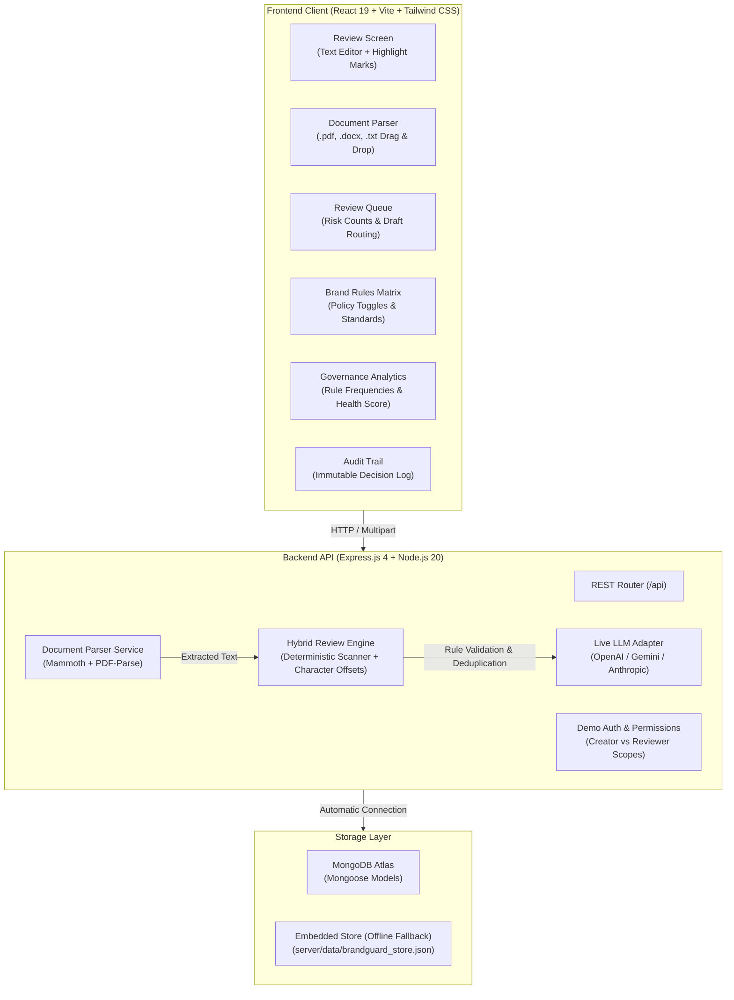

# BrandGuard AI — Pre-Publication Brand Review & Compliance Engine

BrandGuard AI is an automated enterprise brand governance and compliance review platform. It protects brand integrity, enforces legal claim substantiation, prevents non-inclusive or non-compliant terminology, and ensures digital accessibility standards before marketing copy goes live.

---

## 1. System Architecture



---

## 2. Core Capabilities

1. **Deterministic Rule Engine:** Computes exact, inclusive-start / exclusive-end character offsets without mutating text. Covers Rule R-1 (Absolute claims), Rule R-7 (Terminology), and Rule A-2 (Accessibility).
2. **Multi-Provider Live LLM Adapter:** Server-side adapter supporting **OpenAI**, **Google Gemini**, and **Anthropic Claude**. Filters out hallucinations by validating that every semantic finding references an active brand rule ID and quotes an exact substring present in the draft text. Honestly falls back to deterministic mode when no API keys are configured.
3. **PDF / DOCX File Ingestion:** In-memory extraction of text from Word (`.docx`), PDF (`.pdf`), and Text (`.txt`, `.md`) files up to 10MB using pure JS parsers.
4. **Queue-to-Review Flow:** Clicking any item in the Queue routes to `/review?draftId=...&role=reviewer`, loads the selected draft's copy and active findings, hides creator submission buttons, and presents reviewer controls.
5. **Governance Analytics View:** Interactive analytics dashboard (`/analytics`) calculating compliance health rates, total violations, severity risk distribution, and ranking the most frequently violated rules from actual persisted reviews.
6. **Revisions & Character Offset Recalculation:** Accepting a suggested correction creates an incremental revision (`v1` → `v2`), preserves original text in history, and recalculates offsets on the fly.
7. **Policy Gate & Role Enforcement:** Unresolved high-severity findings lock draft submission and block reviewer approval. Dismissals require mandatory justifications, and reviewer decisions require audit comments.

---

## 3. Getting Started & Local Setup

### Prerequisites
- **Node.js** v18.0.0 or higher
- **npm** v9.0.0 or higher

### Step 1: Install Dependencies
```bash
# In the project root (installs React frontend dependencies)
npm install

# In the server folder (installs Express, Mongoose, Multer, Mammoth, PDF-parse)
cd server
npm install
cd ..
```

### Step 2: Configure Environment Variables
Create a `.env` file in `server/` (see `server/.env.example` or `.env.production.example`):

```env
PORT=5000

# Optional: MongoDB Atlas Connection URI
# If omitted or offline, the server runs in persistent embedded mode automatically
MONGODB_URI=mongodb+srv://<username>:<password>@<cluster>.mongodb.net/brandguard?retryWrites=true&w=majority

# Optional: Live LLM Semantic Review Provider
# Supported: 'deterministic' | 'openai' | 'gemini' | 'anthropic'
LLM_PROVIDER=deterministic

# If using OpenAI:
OPENAI_API_KEY=your_openai_key
OPENAI_MODEL=gpt-4o-mini

# If using Gemini:
GEMINI_API_KEY=your_gemini_key
GEMINI_MODEL=gemini-2.5-flash

# If using Anthropic:
ANTHROPIC_API_KEY=your_anthropic_key
ANTHROPIC_MODEL=claude-3-5-haiku-20241022
```

### Step 3: Run Development Servers
```bash
# Terminal 1: Start Express API server (port 5000)
npm run server:start

# Terminal 2: Start Vite Frontend (port 3000)
npm run dev
```

Visit **`http://localhost:3000`** in your browser.

---

## 4. Automated Test Suite & Build Verification

The application includes 4 comprehensive Vitest suites covering unit tests, API integration tests, negative edge cases, Queue-to-Review flows, and document parsing:

```bash
# Run all 4 test suites (43 tests)
npm test

# Run frontend production build (verifies asset optimization and minification)
npm run build
```

### Test Suite Summary (43/43 PASS)
- `server/queue_to_review_bugs.test.js`: Validates draft selection, R-1 claims detection ("Best", "#1", "guaranteed"), count consistency, and reviewer comment gates.
- `server/step7-final-requirements.test.js`: Validates PDF/DOCX buffer parsing, file size gates (10MB limit), LLM status reporting, governance analytics calculations, and auth permissions.
- `server/server.test.js`: Validates CRUD rule toggles, fact verification, and offset calculations.
- `server/step6-edge-cases.test.js`: Validates full end-to-end workflow, negative edge cases, timeout resilience, and persistent storage.

---

## 5. API Endpoints Reference

| Method | Endpoint | Description |
| :--- | :--- | :--- |
| `GET` | `/api/health` | Returns service health and active storage mode (`mongodb` or `embedded`). |
| `GET` | `/api/rules` | Retrieves brand rules, categories, standards, and active status. |
| `PUT` | `/api/rules/:id` | Toggles or edits a rule (records audit log entry). |
| `GET` | `/api/facts` | Retrieves approved facts and substantiating citations. |
| `POST` | `/api/facts` | Adds a new approved empirical claim or fact. |
| `GET` | `/api/reviews/current` | Loads active draft text, revision version, and current findings. |
| `POST` | `/api/reviews/run` | Scans text and returns findings with inclusive-start and exclusive-end offsets. |
| `POST` | `/api/reviews/accept` | Applies fix, generates incremental revision (`v1` → `v2`), and updates offsets. |
| `POST` | `/api/reviews/dismiss` | Dismisses a finding. **Requires a non-empty justification reason**. |
| `POST` | `/api/reviews/submit` | Submits draft for review. **Fails (400) if unresolved high-severity findings exist**. |
| `POST` | `/api/reviews/decision` | Records decision (`Approved`, `Changes requested`, `Rejected`) with mandatory comment. |
| `GET` | `/api/queue` | Returns submissions in the review queue with dynamic high-risk count badges. |
| `GET` | `/api/audit` | Chronological, append-only history of every scan, revision, and approval decision. |
| `POST` | `/api/documents/extract` | Uploads PDF/DOCX/TXT file (max 10MB), extracts text, and optionally triggers review. |
| `GET` | `/api/analytics/governance` | Computes rule violation frequencies, compliance health rate, and category breakdowns. |
| `GET` | `/api/llm/status` | Reports active LLM provider configuration and status honestly. |
| `GET` | `/api/auth/me` | Returns current user profile, role, and permission scopes. |
| `POST` | `/api/auth/switch-role` | Switches demo authenticated role (`creator` vs `reviewer`). |

---

## 6. Security & Safety

1. **No Exposed Secrets:** Server-side environment variables (`.env`) are excluded from Git. No private keys or database passwords are sent to React.
2. **Strict File Upload Validation:** File uploads are checked for allowed extensions (`.pdf`, `.docx`, `.txt`, `.md`), MIME type headers, and a strict 10MB buffer limit. Empty or corrupted files are caught with clear error feedback.
3. **Structured Response Validation:** LLM responses are parsed with JSON schema validation. Any model hallucinations referencing non-existent rule IDs or non-matching text substrings are automatically rejected and recorded.
4. **Deterministic Fallback:** When external LLM credentials are absent, BrandGuard operates in 100% deterministic mode and displays that status honestly in the UI.
5. **Role-Based Permission Scopes:** Distinct permissions separate Creator actions (uploading, editing, submitting) from Reviewer actions (approving, requesting changes, rejecting).

---

## 7. Deployment Instructions

### Option A: Docker / Container Deployment
A multi-stage `Dockerfile` and `docker-compose.yml` are provided in the repository:

```bash
# Build and run BrandGuard AI with MongoDB
docker compose up --build -d

# Verify containers are running
docker compose ps
```
The application will be accessible at `http://localhost:5000`.

### Option B: Render.com Blueprint
1. Connect your GitHub repository to Render.
2. Choose **Blueprint** and select `render.yaml`.
3. Add your `MONGODB_URI` environment variable under the `brandguard-api` web service settings.
4. Deploy the web service and static site.

### Option C: Vercel (Frontend) + Render / Railway (Backend)
1. **Frontend:** Import the project root into Vercel. `vercel.json` ensures client-side routing rewrites work out of the box.
2. **Backend:** Deploy `server/` to Render, Railway, or Fly.io with `PORT=5000` and `MONGODB_URI`.
3. Update `VITE_API_URL` in the frontend environment to point to your deployed backend URL.

---

## 8. Concise 2–3 Minute Live Demo Script / Storyboard

### Scene 1: Queue Inspection & Draft Isolation (0:00 – 0:35)
1. Open `http://localhost:3000/queue`.
2. Point out the Queue items:
   - **Acme Vault Launch Announcement** (1 high issue).
   - **Acme Card Rewards Promotion** (3 high issues: "Best", "#1", "guaranteed").
3. Click **"Review"** on *Acme Card Rewards Promotion*.
4. Notice the URL updates to `/review?draftId=draft-2&role=reviewer`, the header displays *Acme Card Rewards Promotion*, and Reviewer mode is automatically active.

### Scene 2: Uploading a PDF / DOCX Document (0:35 – 1:10)
1. In the header role switcher, switch to **Creator**.
2. Click **"Upload PDF/DOCX"** in the draft toolbar.
3. Select a promotional marketing file (`.docx` or `.pdf`).
4. Watch BrandGuard automatically extract the text, populate the editor, and run the review engine.
5. Observe the live status pill showing extracted words and validated findings.

### Scene 3: Traceability & Resolving Violations (1:10 – 1:50)
1. Click the red highlight on `"guaranteed"`: card **R-1 (Claim Substantiation)** pulses on the right.
2. Point out that the engine detected all 3 absolute claims under R-1 without evidence.
3. Click **"Accept fix"** on Rule R-7 (`"users"` → `"customers"`).
4. Notice that:
   - The text replaces seamlessly.
   - The revision bumps to the next version (`v2`).
   - Character offsets recalculate dynamically without text duplication.
5. Attempt early submission: point out that **"Submit for approval"** remains disabled because high-severity R-1 violations are still open.

### Scene 4: Reviewer Decision with Mandatory Audit Comment (1:50 – 2:25)
1. Switch to **Reviewer** mode. Creator submit buttons disappear; the Reviewer decision controls appear.
2. Try clicking **"Request changes"** without a comment: a red alert appears requiring an audit comment.
3. Type: `"Please remove unsupported absolute claims (Best, #1, guaranteed) before publishing."`
4. Click **"Request changes"**. The status pill updates to **Changes requested**.
5. Press **F5 (Refresh)**: notice the exact draft ID, status, and reviewer mode persist.

### Scene 5: Governance Analytics & Audit Trail (2:25 – 3:00)
1. Click **"Analytics"** in the top navigation bar (`/analytics`).
2. Review the Governance Dashboard:
   - Overall compliance health rate.
   - Most frequently violated rules with exact violation counts and percentages.
   - Severity risk distribution (High vs Medium vs Low).
   - Live AI / Deterministic engine status indicator.
3. Click **"Audit"** to inspect the append-only timeline proving full governance traceability.
