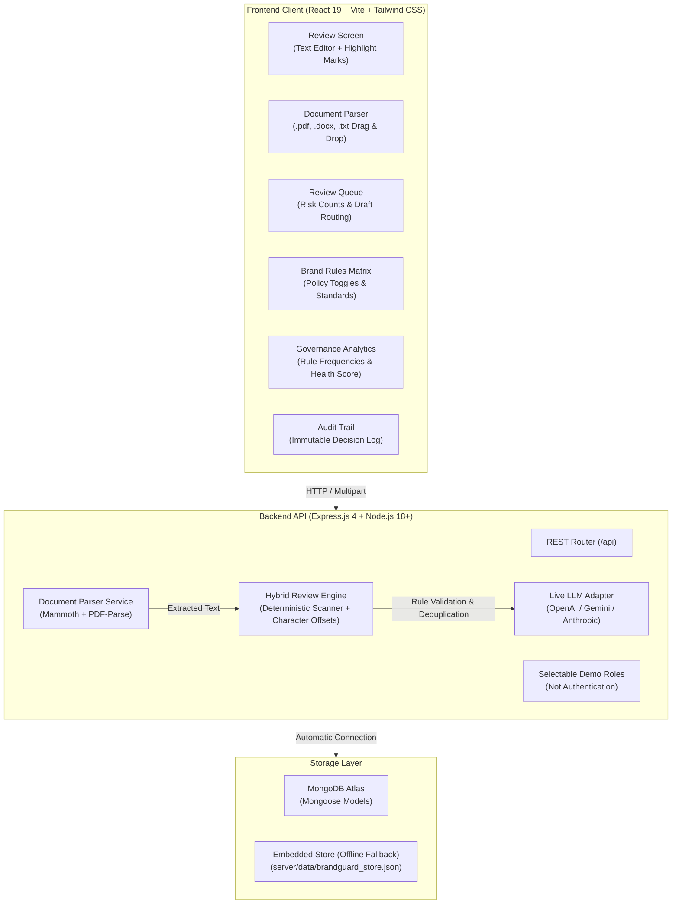

# BrandGuard AI — Pre-Publication Brand Review & Compliance Engine

BrandGuard AI is a college-project prototype for reviewing marketing copy against configurable brand rules. Creators can create and save drafts, scan and resolve findings, upload supported documents, and submit content for reviewer approval. Its deterministic checks are useful demo heuristics, not legal advice or a comprehensive compliance certification.

---

## 1. System Architecture



---

## 2. Core Capabilities

1. **Deterministic Rule Engine:** Computes exact, inclusive-start / exclusive-end character offsets without mutating text. Implements checks for R-1 (selected absolute claims, including bare `100%`), R-7 (terminology), A-2 (non-descriptive links), R-4 (Acme trademark capitalization), and R-9 (a heuristic for promotional-rate APR/fee disclosures). R-9 is not legal advice. Enabled rules without deterministic checks are explicitly reported and block submission/approval.
2. **Multi-Provider Live LLM Adapter:** Server-side adapter supporting **OpenAI**, **Google Gemini**, and **Anthropic Claude**. Filters out hallucinations by validating that every semantic finding references an active brand rule ID and quotes an exact substring present in the draft text. Honestly falls back to deterministic mode when no API keys are configured.
3. **PDF / DOCX File Ingestion:** In-memory extraction of text from Word (`.docx`), PDF (`.pdf`), and Text (`.txt`, `.md`) files up to 10MB using pure JS parsers.
4. **Draft and Review Workflow:** Creators can create, edit, save and reload versioned drafts, scan them, accept fixes, dismiss findings with a reason, and submit for review. Reviewers can open the saved submitted version and record an approval, change request, or rejection with a comment.
5. **Governance Analytics View:** Interactive analytics dashboard (`/analytics`) calculating compliance health rates, total violations, severity risk distribution, and ranking the most frequently violated rules from actual persisted reviews.
6. **Revisions & Character Offset Recalculation:** Saving edited copy or accepting a suggested correction creates a server-assigned revision and recalculates offsets. An edit to approved content returns the draft to Draft and requires a new review.
7. **Policy Gate & Demo Role Checks:** Unresolved high-severity findings block submission and approval. Dismissals require mandatory justifications, and reviewer decisions require audit comments. Role checks are enforced by the API, but selectable demo roles are not secure authentication and must not be treated as identity or access security.

---

## 3. Getting Started & Local Setup

### Prerequisites
- **Node.js** v18.0.0 or higher
- **npm** v9.0.0 or higher

### Step 1: Install Dependencies
```bash
# In the project root (installs React frontend dependencies)
npm install

# In the server folder (installs Express, Mongoose, Multer, Mammoth, PDF-parse)
cd server
npm install
cd ..
```

### Step 2: Configure Environment Variables
Create a `.env` file in `server/` using `server/.env.example` as the template:

```env
PORT=5000

# Local development may omit MongoDB and use the embedded JSON store.
# Production requires a reachable MongoDB connection; it never falls back to JSON.
# MONGODB_URI=mongodb+srv://<username>:<password>@<cluster>.mongodb.net/brandguard?retryWrites=true&w=majority
# REQUIRE_MONGODB=false

# Optional: comma-separated allowed browser origins for a separately hosted frontend
# CORS_ORIGINS=https://your-frontend.example

# Optional: Live LLM Semantic Review Provider
# Supported: 'deterministic' | 'openai' | 'gemini' | 'anthropic'
LLM_PROVIDER=deterministic

# If using OpenAI:
OPENAI_API_KEY=your_openai_key
OPENAI_MODEL=gpt-4o-mini

# If using Gemini:
GEMINI_API_KEY=your_gemini_key
GEMINI_MODEL=gemini-2.5-flash

# If using Anthropic:
ANTHROPIC_API_KEY=your_anthropic_key
ANTHROPIC_MODEL=claude-3-5-haiku-20241022
```

### Step 3: Run Development Servers
```bash
# Terminal 1: Start Express API server (port 5000)
npm run server:start

# Terminal 2: Start Vite Frontend (port 3000)
npm run dev
```

Visit **`http://localhost:3000`** in your browser.

---

## 4. Automated Test Suite & Build Verification

Run these commands from the project root:

```bash
# Run all unit, API, and regression tests
npm test

# Run backend tests only
npm run test:server

# Run the focused frontend logic suite
npm run test:ui

# Build production frontend assets
npm run build
```

Vitest isolates its embedded store in a temporary directory; the checked-in/local demo data file is not modified by the test suites.

### Local browser connection

The Vite development server proxies `/api` to `http://localhost:5000`. The frontend uses same-origin `/api` by default and does not contain server-side API keys. For a separately hosted frontend, set the frontend build variable `VITE_API_URL` to the backend origin (without a trailing `/api`) and set the backend `CORS_ORIGINS` to the exact frontend origin.

The selectable Creator, Reviewer, and Admin roles are demo controls only. The backend checks the selected role header for consistent prototype workflows, but any user can select another role; this is not a secure login or identity system.

Supported deterministic rule IDs are R-1, R-7, A-2, R-4 and R-9. R-9 uses a limited phrase heuristic and requires human review. Any enabled rule outside the deterministic set is shown as unverified and prevents submission/approval rather than being treated as compliant.

---

## 5. API Endpoints Reference

| Method | Endpoint | Description |
| :--- | :--- | :--- |
| `GET` | `/api/health` | Returns service health and active storage mode (`mongodb` or `embedded`). |
| `GET` | `/api/rules` | Retrieves brand rules, categories, standards, and active status. |
| `PUT` | `/api/rules/:id` | Toggles or edits a rule (records audit log entry). |
| `GET` | `/api/facts` | Retrieves approved facts and substantiating citations. |
| `POST` | `/api/facts` | Adds a new approved empirical claim or fact. |
| `PUT` / `DELETE` | `/api/facts/:id` | Updates or deletes an approved fact (Admin demo role). |
| `POST` | `/api/drafts` | Creates a persisted Draft at revision `v1`. |
| `PUT` | `/api/drafts/:id` | Saves a revision using optimistic version checks. |
| `GET` | `/api/reviews/current` | Loads active draft text, revision version, and current findings. |
| `POST` | `/api/reviews/run` | Scans text and returns findings with inclusive-start and exclusive-end offsets. |
| `POST` | `/api/reviews/accept` | Applies fix, generates incremental revision (`v1` → `v2`), and updates offsets. |
| `POST` | `/api/reviews/dismiss` | Dismisses a finding. **Requires a non-empty justification reason**. |
| `POST` | `/api/reviews/submit` | Submits draft for review. **Fails (400) if unresolved high-severity findings exist**. |
| `POST` | `/api/reviews/decision` | Records decision (`Approved`, `Changes requested`, `Rejected`) with mandatory comment. |
| `GET` | `/api/queue` | Returns submissions in the review queue with dynamic high-risk count badges. |
| `GET` | `/api/audit` | Chronological, append-only history of every scan, revision, and approval decision. |
| `POST` | `/api/documents/extract` | Uploads PDF/DOCX/TXT file (max 10MB), extracts text, and optionally triggers review. |
| `GET` | `/api/analytics/governance` | Computes rule violation frequencies, compliance health rate, and category breakdowns. |
| `GET` | `/api/llm/status` | Reports active LLM provider configuration and status honestly. |
| `GET` | `/api/auth/me` | Returns current user profile, role, and permission scopes. |
| `POST` | `/api/auth/switch-role` | Switches demo authenticated role (`creator` vs `reviewer`). |

---

## 6. Security & Safety

1. **No Exposed Secrets:** Server-side environment variables (`.env`) are excluded from Git. No private keys or database passwords are sent to React.
2. **Strict File Upload Validation:** File uploads are checked for allowed extensions (`.pdf`, `.docx`, `.txt`, `.md`), MIME type headers, and a strict 10MB buffer limit. Empty or corrupted files are caught with clear error feedback.
3. **Structured Response Validation:** LLM responses are parsed with JSON schema validation. Any model hallucinations referencing non-existent rule IDs or non-matching text substrings are automatically rejected and recorded.
4. **Deterministic Fallback:** When external LLM credentials are absent, BrandGuard operates in 100% deterministic mode and displays that status honestly in the UI.
5. **Demo Role Checks:** API handlers separate Creator, Reviewer, and Admin actions. The role is selected by the user and sent in a request header; this is not secure authentication and does not establish identity.

---

## 7. Deployment Instructions

### Option A: Docker / Container Deployment
A multi-stage `Dockerfile` and `docker-compose.yml` are provided in the repository:

```bash
# Build and run BrandGuard AI with MongoDB
docker compose up --build -d

# Verify containers are running
docker compose ps
```
The application will be accessible at `http://localhost:5000`.

### Option B: Render backend with Vercel frontend

Use the step-by-step [deployment guide](./DEPLOYMENT_GUIDE.md). `render.yaml` provisions only the API service, requires MongoDB, uses Render's injected `PORT`, and checks `/api/health`. The frontend is deployed separately to Vercel with `VITE_API_URL` set to the Render API origin.

### Option C: Vercel (Frontend) + Render / Railway (Backend)
1. **Frontend:** Import the project root into Vercel. `vercel.json` configures the Vite build and SPA rewrite.
2. **Backend:** Deploy `server/` to a Node host and configure `CORS_ORIGINS` with the exact frontend origin. Configure a persistent database if the host does not preserve local files.
3. Set the frontend build variable `VITE_API_URL` to the backend origin (no `/api` suffix). Keep LLM/database credentials on the backend only.

Deployment must not be considered ready until the production smoke test in [DEPLOYMENT_CHECKLIST.md](./DEPLOYMENT_CHECKLIST.md) confirms the deployed frontend is reading and writing through the Render API and MongoDB Atlas.

---

## 8. Five-Minute Prototype Demonstration

1. Start the backend and frontend with the local commands above; open `http://localhost:3000`.
2. Leave the demo role set to **Creator**. Select **Create draft**, enter a short title, then edit the sample copy to include `100% guaranteed` and `users`.
3. Click **Save draft**, refresh the browser, and confirm the saved text and revision reload.
4. Run the review. Inspect the R-1 and R-7 explanations. Accept a suggested R-7 fix, then dismiss an active finding only after entering an audit justification.
5. Submit a clean or fully resolved draft. Open **Queue**, switch to **Reviewer**, add a decision comment, and record a decision. Confirm that only submitted drafts appear in the queue.
6. Visit **Rules** to toggle a rule as Admin, and **Audit** / **Analytics** to show persisted changes and governance metrics.

The reviewer/admin switcher is intentionally demo-only. Never present it as production authentication. The deterministic checks cover the supported rules documented above; R-9 remains a narrow heuristic that needs human verification.
